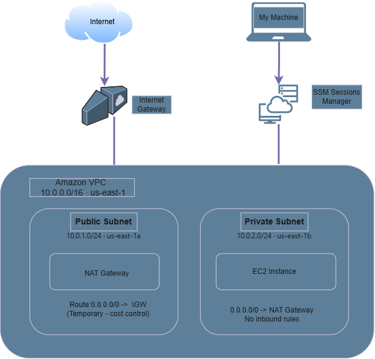
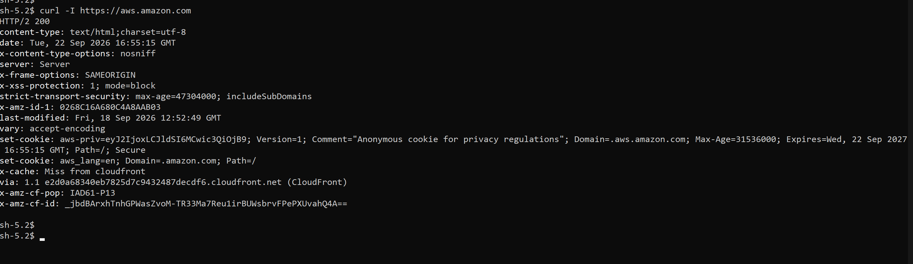

VPC with Public/Private Subnet Isolation

## What this is
A VPC built to understand the core pattern behind most production cloud 
networks: separating what's exposed to the internet from what isn't, 
enforced through routing rather than naming or convention.

## Architecture diagram


## Resources created
| Resource | ID | Purpose |
|---|---|---|
| VPC | vpc-00f047b684c04f7de | Isolated network, 10.0.0.0/16 |
| Public subnet | subnet-0b4f506745a89011b | 10.0.1.0/24, us-east-1a |
| Private subnet | subnet-080e167d1f4b70b1b | 10.0.2.0/24, us-east-1b |
| Internet Gateway | igw-018a7a096b252a841 | Internet access for public subnet |
| Public route table | rtb-0fcfcc81e8954c495 | Routes 0.0.0.0/0 → IGW, associated with public subnet |
| NAT Gateway | *(in progress)* | Outbound internet for private subnet |
| IAM role (SSM) | *(in progress)* | Lets SSM manage the instance, no SSH needed |
| EC2 instance | *(in progress)* | Launched in private subnet, managed via SSM |
| Private route table | rtb-091298343a37520ed | Routes 0.0.0.0/0 → NAT Gateway, associated with private subnet |
| NAT Gateway | nat-0cd07bd815f86fbda | Outbound-only internet for private subnet — created, tested, deleted same session |
| Elastic IP | eipalloc-077e3f5060cf8ec9a | Attached to NAT Gateway — released after teardown |
| IAM role | ssm-ec2-role | Lets the instance be managed by SSM, no SSH needed |
| Instance profile | ssm-ec2-profile | Wraps the role for EC2 attachment |
| Security group | sg-008a8061758d065bc | Zero inbound rules — SSM needs none |
| EC2 instance | i-0c30e77e9e01f5ac1 | t2.micro, private subnet, SSM-managed — terminated after verification |

## Design decisions
- Split subnets across two Availability Zones (us-east-1a / us-east-1b) 
  so a single data-center outage doesn't take down both.
- Isolation is enforced by the route table, not a setting — the private 
  subnet simply has no route to the internet gateway.
- Created a dedicated route table for the private subnet rather than 
  relying on the VPC's default, making the isolation an explicit design 
  choice rather than an accidental side effect.
## Design evolution
Originally planned with a bastion host in the public subnet, SSH access 
restricted to a single IP via security group. This proved impractical 
since my IP changes across locations. Pivoted to AWS Systems Manager (SSM) 
Session Manager: the instance moved into the private subnet with no 
inbound rules at all, and access is authenticated through IAM instead of 
network location.

## Troubleshooting: SSM Agent Not Registering
After launching the private instance, `aws ssm start-session` failed with 
`TargetNotConnected`, and `describe-instance-information` returned an empty 
list.

Ruled out systematically: VPC DNS support (enabled), NAT Gateway state and 
Elastic IP attachment (correct), private subnet's route to the NAT Gateway 
(correct), public subnet's route to the IGW (correct), security group 
outbound rules (fully open by default), IAM instance profile attachment 
(confirmed attached), instance health checks (passing). Terminated and 
relaunched the instance in case of a boot-time race condition — issue 
persisted.

**Root cause:** the AMI selected by a wildcard filter (`al2023-ami-*-x86_64`) 
matched Amazon Linux 2023's "minimal" variant, which doesn't ship with the 
SSM Agent pre-installed — unlike the standard AL2023 AMI. Every networking 
and IAM check passed because the problem was never connectivity or 
permissions; there was no agent present to register in the first place.

**Fix:** used AWS's official SSM parameter for the current standard AL2023 
AMI instead of a wildcard search:

```
$ aws ssm get-parameter --name "/aws/service/ami-amazon-linux-latest/al2023-ami-kernel-default-x86_64" --query "Parameter.Value" --output text
ami-0db58a8e82c5175f8
```

Relaunched with this AMI. SSM Agent registered successfully within minutes.

## Verification

**1. SSM session connected to the private instance.** The instance has no 
public IP and no inbound rules, yet a shell session opened, authenticated 
through IAM alone:


**2. Outbound connectivity through the NAT Gateway.** From inside that 
session, `curl -I https://aws.amazon.com` returned `HTTP/2 200`, confirming 
the NAT Gateway and private route table work independently of SSM's own 
connection:


