# Week 1 Solo Project: Secure Three-Tier AWS Network

> A three-tier network on AWS (web, app, data) built entirely with the AWS CLI. Every connection is allowed deliberately, and everything else is blocked by routing, security groups, or IAM. A private S3 bucket serves a static site through CloudFront, and every instance is managed through SSM with no SSH and no stored credentials.

**Live static site:** https://d2u5gyogtmqzqc.cloudfront.net (the bucket is private, and CloudFront is the only way in)

## Contents
1. [Overview](#1-overview)
2. [Architecture](#2-architecture)
3. [Resources created](#3-resources-created)
4. [Design decisions](#4-design-decisions)
5. [Build walkthrough](#5-build-walkthrough)
6. [Configuration files](#6-configuration-files)
7. [Verification](#7-verification)
8. [Troubleshooting and notes](#8-troubleshooting-and-notes)
9. [Cost](#9-cost)
10. [Teardown](#10-teardown)
11. [Next steps](#11-next-steps)
12. [Repository contents](#12-repository-contents)

---

## 1. Overview

This project extends my first VPC build (public/private subnets with SSM access) into a classic three-tier layout, where each tier can talk only to the tier next to it. The goal was least privilege: prove that the right traffic flows, and that everything else is blocked.

| | |
|---|---|
| **Region / AZ** | us-east-1, single AZ (us-east-1a) to control cost |
| **Built with** | AWS CLI v2 on Windows (Command Prompt), VS Code for JSON files |
| **Access method** | AWS Systems Manager Session Manager (IAM-authenticated, no SSH, no key pairs) |
| **Compute** | Three t2.micro instances, one per tier, as stand-ins for real services |

**Skills demonstrated:** VPC design and routing, tier isolation with security-group references, writing a least-privilege IAM policy, private S3 + CloudFront with Origin Access Control, VPC interface endpoints for an isolated subnet, negative testing (proving things are blocked), cost control with a create-test-destroy workflow.

---

## 2. Architecture

### Overall layout

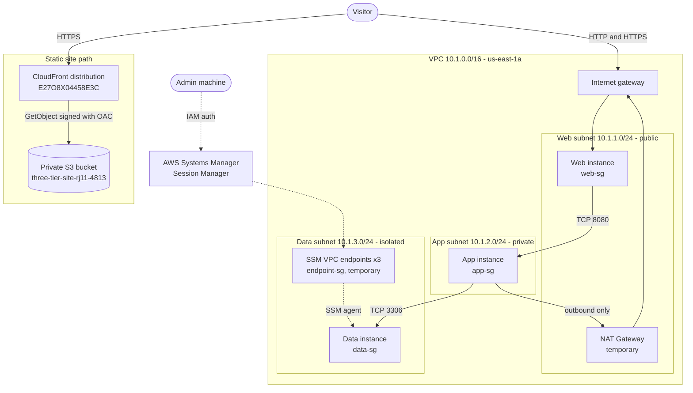

<!-- Optional: add a draw.io export of the same layout here

-->

### Who can talk to whom

| Flow | Mechanism | Result |
|---|---|---|
| Visitor to static site | CloudFront reads the bucket through OAC, bucket policy scoped to one distribution | Allowed |
| Visitor to S3 directly | Bucket is private | Denied (403) |
| Internet to web tier | `web-rt` route to the IGW, `web-sg` allows 80 and 443 | Allowed |
| Web to app | `app-sg` allows TCP 8080 from `web-sg` | Allowed |
| App to data | `data-sg` allows TCP 3306 from `app-sg` | Allowed |
| Web to data | `data-sg` has no rule for `web-sg` | **Blocked** |
| App to internet | `app-rt` default route to the NAT Gateway | Outbound only |
| Data to internet | `data-rt` has no default route | **Blocked** |
| Admin to instances | SSM session, authenticated by IAM, no inbound rules | Allowed |

### Security-group chain

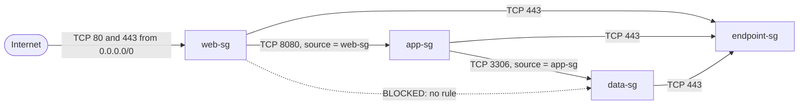

### Static site access path

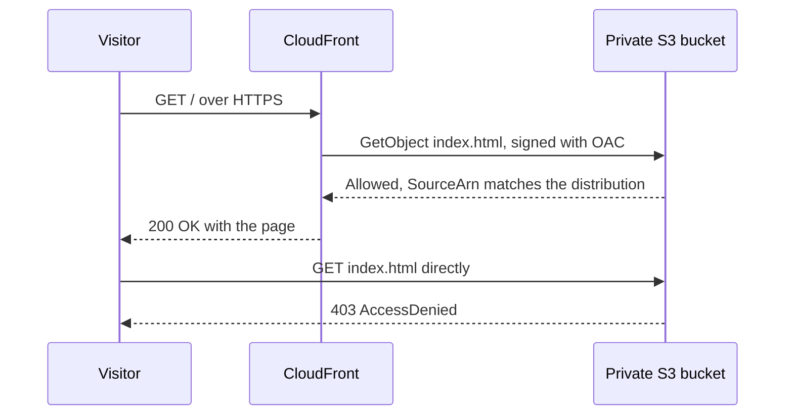

### Build order

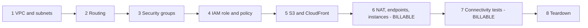

---

## 3. Resources created

Resources marked **(temporary)** were created for the test window and deleted afterwards.

### Network

| Resource | Name | ID | Details |
|---|---|---|---|
| VPC | three-tier-vpc | `vpc-0a873231b1dda8bdd` | 10.1.0.0/16, DNS hostnames enabled |
| Web subnet | web-subnet | `subnet-05f199a9fcc22f65a` | 10.1.1.0/24, us-east-1a, auto-assign public IP |
| App subnet | app-subnet | `subnet-0f108d9584e77dfa0` | 10.1.2.0/24, us-east-1a |
| Data subnet | data-subnet | `subnet-0eb05c9474a534b67` | 10.1.3.0/24, us-east-1a |
| Internet gateway | three-tier-igw | `igw-099940e5245f2e482` | Attached to the VPC |
| NAT Gateway (temporary) | | `nat-088dec25b2264fe8b` | In the web subnet |
| Elastic IP (temporary) | | `eipalloc-055ebbb112816c6cf` | Attached to the NAT Gateway |
| VPC endpoints (temporary) | ssm, ssmmessages, ec2messages | `vpce-02a144a98b30e055d`, `vpce-0926d2b45ff58f15f`, `vpce-03b9cfae93e16a22e` | Interface endpoints in the data subnet, private DNS on |

### Route tables

| Table | ID | Associated with | Routes |
|---|---|---|---|
| web-rt | `rtb-01a2c26e182d2851d` | Web subnet | local, `0.0.0.0/0` to `igw-099940e5245f2e482` |
| app-rt | `rtb-08b5fce4189c6c2a2` | App subnet | local, `0.0.0.0/0` to `nat-088dec25b2264fe8b` (temporary) |
| data-rt | `rtb-0754f83c736533eca` | Data subnet | local only |

### Security groups

| Group | ID | Inbound rules |
|---|---|---|
| web-sg | `sg-02ce4434585f69602` | TCP 80 and 443 from 0.0.0.0/0 |
| app-sg | `sg-08e64bfdeea2d7b30` | TCP 8080 from `web-sg` |
| data-sg | `sg-06ccd7fd92cd9911b` | TCP 3306 from `app-sg` |
| endpoint-sg | `sg-0fe456ee15f961583` | TCP 443 from `web-sg`, `app-sg`, and `data-sg` |

Outbound rules are the AWS default (allow all) on every group. No group opens port 22.

### IAM

| Resource | Name | Identifier |
|---|---|---|
| Role | three-tier-ec2-role | `arn:aws:iam::629324192780:role/three-tier-ec2-role` |
| Custom policy | three-tier-s3-read | `arn:aws:iam::629324192780:policy/three-tier-s3-read` (ID `ANPAZFBVFDQGF75N3BLJJ`) |
| Managed policy | AmazonSSMManagedInstanceCore | `arn:aws:iam::aws:policy/AmazonSSMManagedInstanceCore` |
| Instance profile | three-tier-profile | `arn:aws:iam::629324192780:instance-profile/three-tier-profile` (ID `AIPAZFBVFDQGM63MBOCIP`) |

### Static site

| Resource | Name | Identifier |
|---|---|---|
| S3 bucket | three-tier-site-rj11-4813 | us-east-1, block public access on |
| Origin Access Control | three-tier-oac | `E3KN9ERVO5SYHN` |
| CloudFront distribution | | `E27O8X04458E3C` |
| Distribution ARN | | `arn:aws:cloudfront::629324192780:distribution/E27O8X04458E3C` |
| Distribution domain | | `d2u5gyogtmqzqc.cloudfront.net` |
| Bucket policy | | Admits only the distribution above (see [Configuration files](#6-configuration-files)) |

### Compute (temporary)

| Instance | ID | Private IP | Subnet / security group |
|---|---|---|---|
| web-instance | `i-06601cb403e1f9b3e` | 10.1.1.107 | web / `web-sg` |
| app-instance | `i-05c65aa9689001fa1` | 10.1.2.42 | app / `app-sg` |
| data-instance | `i-0801713555286b066` | 10.1.3.214 | data / `data-sg` |

All three: t2.micro, AMI `ami-0c230065b91270bc6` (Amazon Linux 2023, looked up through the AWS SSM public parameter), instance profile `three-tier-profile`, no key pair.

---

## 4. Design decisions

- **The data tier's route table has no default route.** Its isolation comes from what was left out, so even a misconfigured security group could not expose it to the internet.
- **Security groups reference each other, not IP ranges.** The app tier accepts 8080 only from `web-sg`, and the data tier accepts 3306 only from `app-sg`. The rules keep working if instance IPs change.
- **No SSH anywhere.** Access is through SSM, authenticated by IAM, so there is no inbound management port and no key file to protect.
- **VPC interface endpoints for the data tier.** With no internet route, the SSM agent there cannot reach AWS the normal way. The endpoints give it a private path. With private DNS enabled, the SSM hostname resolves to the endpoints for the whole VPC, so `endpoint-sg` admits port 443 from all three tiers.
- **Least-privilege IAM.** A dedicated role for this project with a custom policy that allows one action (`s3:GetObject`) on one bucket, plus the managed SSM policy. No access keys on any instance.
- **Private bucket behind CloudFront using Origin Access Control** (the current method, not the deprecated Origin Access Identity). The bucket policy admits only this distribution's ARN. The distribution allows `GET` and `HEAD` only and redirects HTTP to HTTPS.
- **Regional S3 domain as the CloudFront origin**, not the website endpoint. The website endpoint requires a public bucket and cannot use OAC.
- **Single Availability Zone** to keep cost down. Production would replicate each tier across two AZs, with a NAT Gateway per AZ.
- **Temporary billable resources.** The NAT Gateway, endpoints, and instances existed only for the test window.

---

## 5. Build walkthrough

Each command returns an ID. Substitute it for the matching `<placeholder>` in later commands. On Windows Command Prompt, remove the angle brackets when you substitute (`<` is a redirect operator and causes a "cannot find the file specified" error). Run commands one at a time. Many commands return nothing on success.

### Phase 1: VPC and subnets (free)

**Purpose:** create the isolated address space and carve it into three tiers.

```
aws ec2 create-vpc --cidr-block 10.1.0.0/16
aws ec2 modify-vpc-attribute --vpc-id <vpc-id> --enable-dns-hostnames
aws ec2 create-subnet --vpc-id <vpc-id> --cidr-block 10.1.1.0/24 --availability-zone us-east-1a
aws ec2 create-subnet --vpc-id <vpc-id> --cidr-block 10.1.2.0/24 --availability-zone us-east-1a
aws ec2 create-subnet --vpc-id <vpc-id> --cidr-block 10.1.3.0/24 --availability-zone us-east-1a
aws ec2 modify-subnet-attribute --subnet-id <web-subnet-id> --map-public-ip-on-launch
aws ec2 create-tags --resources <resource-id> --tags Key=Name,Value=<name>
```

DNS hostnames are enabled now because the VPC endpoints in Phase 6 need them. The tags command is repeated for each resource. Only the web subnet auto-assigns public IPs.

### Phase 2: Routing (free)

**Purpose:** give each tier a different level of internet access.

```
aws ec2 create-internet-gateway
aws ec2 attach-internet-gateway --internet-gateway-id <igw-id> --vpc-id <vpc-id>
aws ec2 create-route-table --vpc-id <vpc-id>
aws ec2 create-route --route-table-id <web-rt-id> --destination-cidr-block 0.0.0.0/0 --gateway-id <igw-id>
aws ec2 associate-route-table --route-table-id <web-rt-id> --subnet-id <web-subnet-id>
```

Run `create-route-table` three times (web, app, data), and `associate-route-table` once per tier. Add the internet route only to `web-rt`. `app-rt` gets its NAT route in Phase 6, and `data-rt` never gets a default route.

### Phase 3: Security groups (free)

**Purpose:** chain the tiers so each trusts only the one in front of it.

```
aws ec2 create-security-group --group-name web-sg --description web-tier --vpc-id <vpc-id>
aws ec2 create-security-group --group-name app-sg --description app-tier --vpc-id <vpc-id>
aws ec2 create-security-group --group-name data-sg --description data-tier --vpc-id <vpc-id>
aws ec2 authorize-security-group-ingress --group-id <web-sg-id> --protocol tcp --port 80 --cidr 0.0.0.0/0
aws ec2 authorize-security-group-ingress --group-id <web-sg-id> --protocol tcp --port 443 --cidr 0.0.0.0/0
aws ec2 authorize-security-group-ingress --group-id <app-sg-id> --protocol tcp --port 8080 --source-group <web-sg-id>
aws ec2 authorize-security-group-ingress --group-id <data-sg-id> --protocol tcp --port 3306 --source-group <app-sg-id>
```

`--source-group` replaces `--cidr`, so the rule means "anything in that security group."

### Phase 4: IAM role and custom policy (free)

**Purpose:** let the instances be managed through SSM and read exactly one bucket, with no stored credentials. Needs `trust-policy.json` and `s3-read-policy.json` (see [Configuration files](#6-configuration-files)) in the working directory, and the bucket must exist first.

```
aws s3api create-bucket --bucket <bucket-name> --region us-east-1
aws s3api put-public-access-block --bucket <bucket-name> --public-access-block-configuration BlockPublicAcls=true,IgnorePublicAcls=true,BlockPublicPolicy=true,RestrictPublicBuckets=true
aws iam create-role --role-name three-tier-ec2-role --assume-role-policy-document file://trust-policy.json
aws iam attach-role-policy --role-name three-tier-ec2-role --policy-arn arn:aws:iam::aws:policy/AmazonSSMManagedInstanceCore
aws iam create-policy --policy-name three-tier-s3-read --policy-document file://s3-read-policy.json
aws iam attach-role-policy --role-name three-tier-ec2-role --policy-arn <policy-arn>
aws iam create-instance-profile --instance-profile-name three-tier-profile
aws iam add-role-to-instance-profile --instance-profile-name three-tier-profile --role-name three-tier-ec2-role
```

### Phase 5: Static site with S3 and CloudFront (free tier)

**Purpose:** serve a page publicly while the bucket stays private. The OAC gives CloudFront an identity, and the bucket policy admits only requests from this specific distribution.

```
aws s3 cp index.html s3://<bucket-name>/
aws cloudfront create-origin-access-control --origin-access-control-config file://oac-config.json
aws cloudfront create-distribution --distribution-config file://distribution-config.json
aws cloudfront get-distribution --id <distribution-id> --query Distribution.Status
aws s3api put-bucket-policy --bucket <bucket-name> --policy file://bucket-policy.json
```

Put the OAC ID into `distribution-config.json` first, and the distribution ID into `bucket-policy.json` after. The distribution takes 5 to 15 minutes to reach `Deployed`.

### Phase 6: Billable test window

**Purpose:** create the pieces that cost money only while the tests run, then delete them. Billing starts at the NAT Gateway.

```
aws ssm get-parameter --name /aws/service/ami-amazon-linux-latest/al2023-ami-kernel-default-x86_64 --query Parameter.Value --output text
aws ec2 create-security-group --group-name endpoint-sg --description ssm-endpoints --vpc-id <vpc-id>
aws ec2 authorize-security-group-ingress --group-id <endpoint-sg-id> --protocol tcp --port 443 --source-group <web-sg-id>
aws ec2 authorize-security-group-ingress --group-id <endpoint-sg-id> --protocol tcp --port 443 --source-group <app-sg-id>
aws ec2 authorize-security-group-ingress --group-id <endpoint-sg-id> --protocol tcp --port 443 --source-group <data-sg-id>
aws ec2 allocate-address --domain vpc
aws ec2 create-nat-gateway --subnet-id <web-subnet-id> --allocation-id <allocation-id>
aws ec2 describe-nat-gateways --nat-gateway-ids <nat-gateway-id> --query NatGateways[0].State
aws ec2 create-route --route-table-id <app-rt-id> --destination-cidr-block 0.0.0.0/0 --nat-gateway-id <nat-gateway-id>
aws ec2 create-vpc-endpoint --vpc-id <vpc-id> --vpc-endpoint-type Interface --service-name com.amazonaws.us-east-1.ssm --subnet-ids <data-subnet-id> --security-group-ids <endpoint-sg-id> --private-dns-enabled
aws ec2 create-vpc-endpoint --vpc-id <vpc-id> --vpc-endpoint-type Interface --service-name com.amazonaws.us-east-1.ssmmessages --subnet-ids <data-subnet-id> --security-group-ids <endpoint-sg-id> --private-dns-enabled
aws ec2 create-vpc-endpoint --vpc-id <vpc-id> --vpc-endpoint-type Interface --service-name com.amazonaws.us-east-1.ec2messages --subnet-ids <data-subnet-id> --security-group-ids <endpoint-sg-id> --private-dns-enabled
aws ec2 run-instances --image-id <ami-id> --instance-type t2.micro --subnet-id <subnet-id> --security-group-ids <sg-id> --iam-instance-profile Name=three-tier-profile
aws ssm describe-instance-information --query InstanceInformationList[*].[InstanceId,PingStatus]
```

Wait for the NAT Gateway to show `available` before adding the route. Run `run-instances` once per tier, matching each subnet with its own security group. Wait until all three instances show `Online` in SSM.

The AMI comes from the AWS public SSM parameter instead of a name search. A wildcard search can match the "minimal" Amazon Linux image, which does not include the SSM agent.

### Phase 7: Connectivity tests

See [Verification](#7-verification).

### Phase 8: Teardown


---

## 6. Configuration files

<details>
<summary><code>trust-policy.json</code> (lets EC2 assume the role)</summary>

```json
{
  "Version": "2012-10-17",
  "Statement": [
    {
      "Effect": "Allow",
      "Principal": {
        "Service": "ec2.amazonaws.com"
      },
      "Action": "sts:AssumeRole"
    }
  ]
}
```

</details>

<details>
<summary><code>s3-read-policy.json</code> (least-privilege policy: one action, one bucket)</summary>

```json
{
  "Version": "2012-10-17",
  "Statement": [
    {
      "Effect": "Allow",
      "Action": "s3:GetObject",
      "Resource": "arn:aws:s3:::three-tier-site-rj11-4813/*"
    }
  ]
}
```

The `/*` is there because `GetObject` applies to objects inside the bucket. `ListBucket` was deliberately not granted.

</details>

<details>
<summary><code>oac-config.json</code> (CloudFront's identity to S3)</summary>

```json
{
  "Name": "three-tier-oac",
  "Description": "OAC for the three-tier site bucket",
  "SigningProtocol": "sigv4",
  "SigningBehavior": "always",
  "OriginAccessControlOriginType": "s3"
}
```

</details>

<details>
<summary><code>distribution-config.json</code> (the CloudFront distribution)</summary>

```json
{
  "CallerReference": "three-tier-site-001",
  "Comment": "Three-tier project static site",
  "Enabled": true,
  "DefaultRootObject": "index.html",
  "Origins": {
    "Quantity": 1,
    "Items": [
      {
        "Id": "s3-three-tier-site",
        "DomainName": "three-tier-site-rj11-4813.s3.us-east-1.amazonaws.com",
        "OriginAccessControlId": "E3KN9ERVO5SYHN",
        "S3OriginConfig": {
          "OriginAccessIdentity": ""
        }
      }
    ]
  },
  "DefaultCacheBehavior": {
    "TargetOriginId": "s3-three-tier-site",
    "ViewerProtocolPolicy": "redirect-to-https",
    "AllowedMethods": {
      "Quantity": 2,
      "Items": ["GET", "HEAD"],
      "CachedMethods": {
        "Quantity": 2,
        "Items": ["GET", "HEAD"]
      }
    },
    "CachePolicyId": "658327ea-f89d-4fab-a63d-7e88639e58f6"
  }
}
```

`CachePolicyId` is AWS's managed CachingOptimized policy. `OriginAccessIdentity` stays empty because OAC is used.

</details>

<details>
<summary><code>bucket-policy.json</code> (admits only this distribution)</summary>

```json
{
  "Version": "2012-10-17",
  "Statement": [
    {
      "Sid": "AllowCloudFrontReadOnly",
      "Effect": "Allow",
      "Principal": {
        "Service": "cloudfront.amazonaws.com"
      },
      "Action": "s3:GetObject",
      "Resource": "arn:aws:s3:::three-tier-site-rj11-4813/*",
      "Condition": {
        "StringEquals": {
          "AWS:SourceArn": "arn:aws:cloudfront::629324192780:distribution/E27O8X04458E3C"
        }
      }
    }
  ]
}
```

The `AWS:SourceArn` condition is what stops any other CloudFront distribution from reading the bucket.

</details>

<details>
<summary><code>index.html</code></summary>

```html
<!DOCTYPE html>
<html>
  <head>
    <title>Three-Tier Project</title>
  </head>
  <body>
    <h1>Three-tier VPC project</h1>
    <p>Served privately from S3 through CloudFront.</p>
  </body>
</html>
```

</details>

---

## 7. Verification

### Connectivity tests

Each test ran from an SSM session on the named instance. First, a stand-in server was started on the app and data instances so that a failed test could not be explained by "nothing was listening":

```
# on the app instance
cd /tmp
python3 -m http.server 8080 > /dev/null 2>&1 &

# on the data instance
cd /tmp
python3 -m http.server 3306 > /dev/null 2>&1 &
```

| # | From to | Command | Expected | Result | Evidence |
|---|---|---|---|---|---|
| 1 | Web to App :8080 | `curl -I -m 5 http://10.1.2.42:8080` | Allowed | 200 OK | 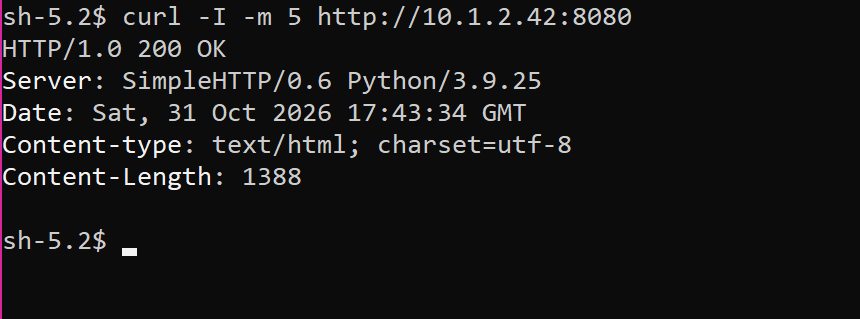 |
| 2 | App to Data :3306 | `curl -I -m 5 http://10.1.3.214:3306` | Allowed | 200 OK | 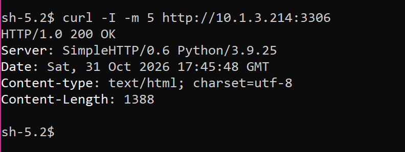 |
| 3 | Web to Data :3306 | `curl -I -m 5 http://10.1.3.214:3306` | **Blocked** | Timed out | 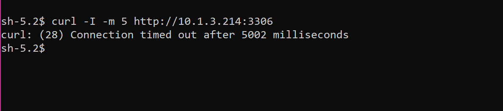 |
| 4 | App to internet | `curl -I -m 5 https://aws.amazon.com` | Allowed (via NAT) | 200 | 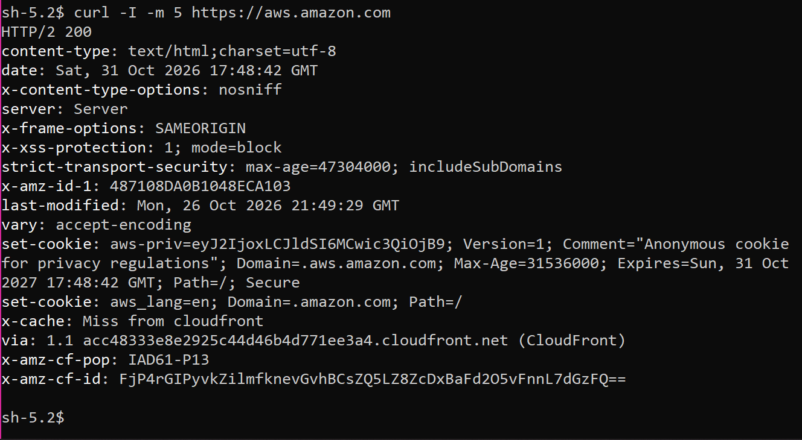 |
| 5 | Data to internet | `curl -I -m 5 https://aws.amazon.com` | **Blocked** (no route) | Timed out | 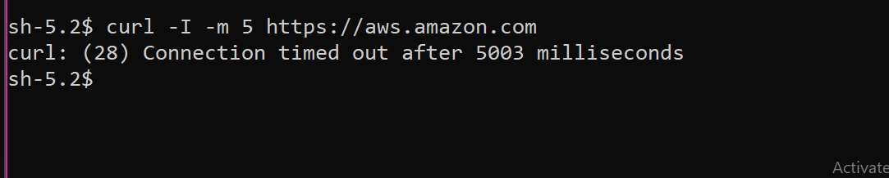 |

Test 2 doubles as a control. The data server was up and reachable from the app tier, so the timeout in Test 3 can only come from the security group. A blocked connection looks like a timeout, not "connection refused," because security groups drop disallowed traffic silently.

### IAM policy

From the app instance, using the instance role (no access keys configured):

```
aws s3 cp s3://three-tier-site-rj11-4813/index.html - --region us-east-1
aws s3 ls s3://three-tier-site-rj11-4813/ --region us-east-1
```

The first printed the page (`GetObject` is allowed). The second returned `AccessDenied`, because `ListBucket` was never granted.

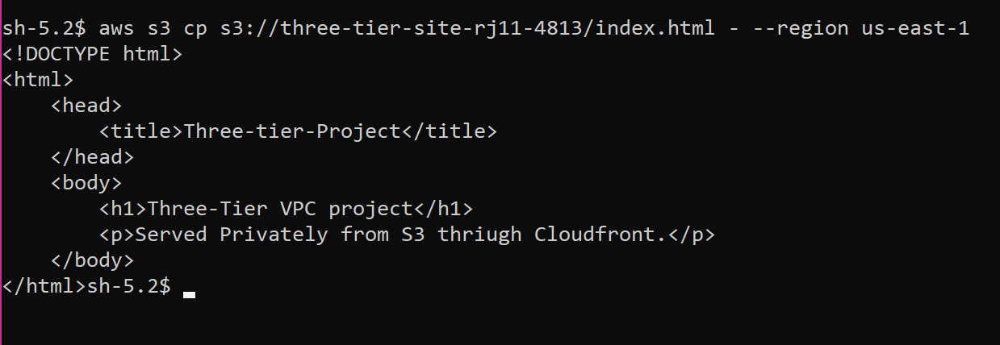
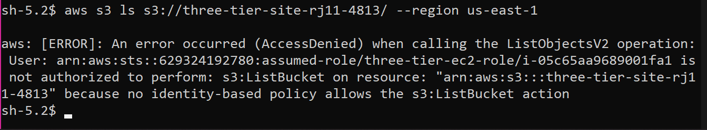

### Static site

| Test | Result | Evidence |
|---|---|---|
| Direct S3 URL (`https://three-tier-site-rj11-4813.s3.amazonaws.com/index.html`) | AccessDenied, both before and after the bucket policy was applied | 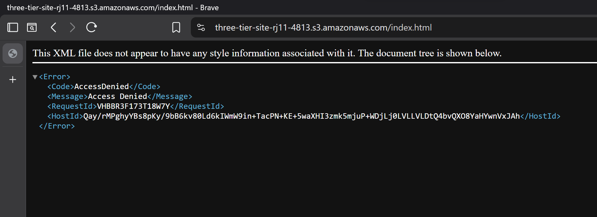 |
| CloudFront URL (`https://d2u5gyogtmqzqc.cloudfront.net`) | Page served over HTTPS at the root path | 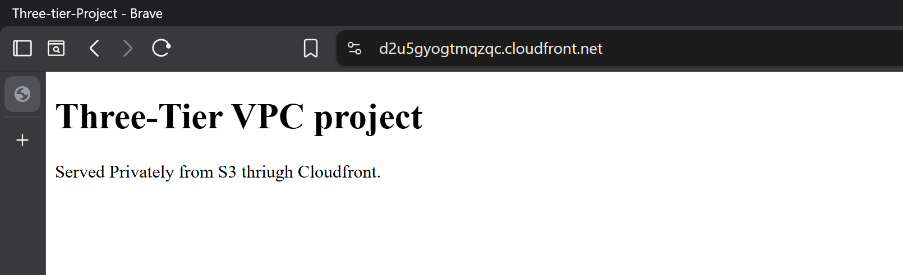 |

### Supporting evidence

All three instances registered with SSM.

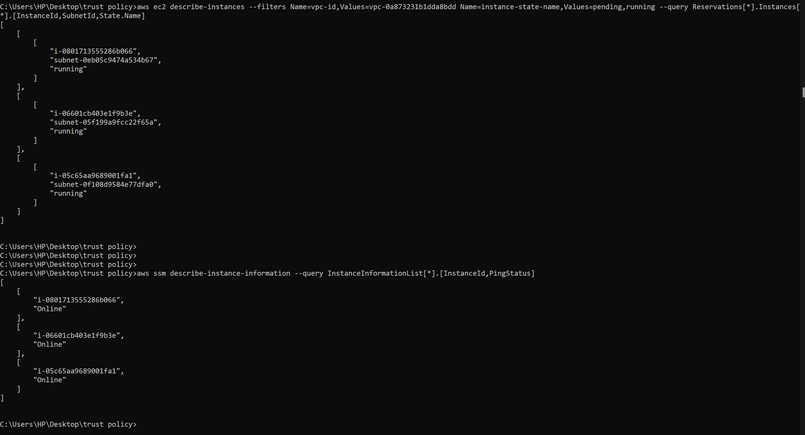


---

## 8. Troubleshooting and notes

### MalformedPolicyDocument when creating the IAM policy

`aws iam create-policy` failed with `MalformedPolicyDocument: The policy failed legacy parsing`, although the JSON looked correct in the editor.

- **Checked:** the Resource ARN format, straight vs curly quotes, braces and commas, unsaved edits, file encoding, and stray whitespace.
- **Root cause:** (fill in what actually fixed it)
- **Takeaway:** (fill in)

### Notes from the build

- **The endpoint security group must admit all three tiers.** Private DNS makes the SSM hostname resolve to the endpoints VPC-wide, so web and app traffic goes through them too.
- **DNS hostnames must be enabled on the VPC** before creating the endpoints. A VPC created from the CLI has it off by default.
- **Use the regional S3 domain as the CloudFront origin.** The website endpoint does not work with a private bucket and OAC.
- **Release the Elastic IP only after the NAT Gateway reaches `deleted`.** Releasing early fails, and an unattached address keeps billing.
- **Several commands return nothing on success** (policy attachments, route-table associations, tagging). No output is the expected result.

---

## 9. Cost

The billable resources (NAT Gateway, three interface endpoints, three t2.micro instances) ran for about (fill in) hours at roughly $0.10 to $0.12 per hour. Everything else (VPC, subnets, route tables, security groups, IAM, S3, and CloudFront at this traffic level) is free or costs fractions of a cent. The billable resources were created only when the tests were ready to run and deleted straight afterwards.

---

## 10. Teardown

The billable resources were removed immediately after testing:

```
aws ec2 delete-nat-gateway --nat-gateway-id nat-088dec25b2264fe8b
aws ec2 delete-vpc-endpoints --vpc-endpoint-ids vpce-02a144a98b30e055d vpce-0926d2b45ff58f15f vpce-03b9cfae93e16a22e
aws ec2 terminate-instances --instance-ids i-06601cb403e1f9b3e i-05c65aa9689001fa1 i-0801713555286b066
aws ec2 release-address --allocation-id eipalloc-055ebbb112816c6cf
```

The Elastic IP was released only after the NAT Gateway showed `deleted`. Verified clean afterwards:

```
aws ec2 describe-nat-gateways --filter Name=vpc-id,Values=vpc-0a873231b1dda8bdd --query NatGateways[*].[NatGatewayId,State]
aws ec2 describe-vpc-endpoints --filters Name=vpc-id,Values=vpc-0a873231b1dda8bdd --query VpcEndpoints[*].[VpcEndpointId,State]
aws ec2 describe-instances --filters Name=vpc-id,Values=vpc-0a873231b1dda8bdd Name=instance-state-name,Values=pending,running,stopping,stopped --query Reservations[*].Instances[*].InstanceId
aws ec2 describe-addresses
```


After the NAT Gateway was deleted, the `0.0.0.0/0` route in `app-rt` shows as `blackhole`, which is harmless. The VPC, subnets, route tables, security groups, IAM resources, S3 bucket, and CloudFront distribution cost nothing and were left in place.

---

## 11. Next steps

- Span two Availability Zones per tier, with a NAT Gateway in each AZ.
- Replace the stand-in instances with real services: an application server in the app tier and RDS in the data tier.
- Put an Application Load Balancer in front of the web tier and add AWS WAF.
- Tighten outbound security-group rules instead of relying on the default allow-all.
- Enable VPC Flow Logs to record which connections were accepted and rejected.
- Rebuild the whole environment as Terraform (the Week 3 infrastructure-as-code project).

---

## 12. Repository contents

```
week-1-solo-3tier/
├── README.md
├── trust-policy.json
├── s3-read-policy.json
├── oac-config.json
├── distribution-config.json
├── bucket-policy.json
├── index.html
├── build-log.md
└── screenshots (png)
```
